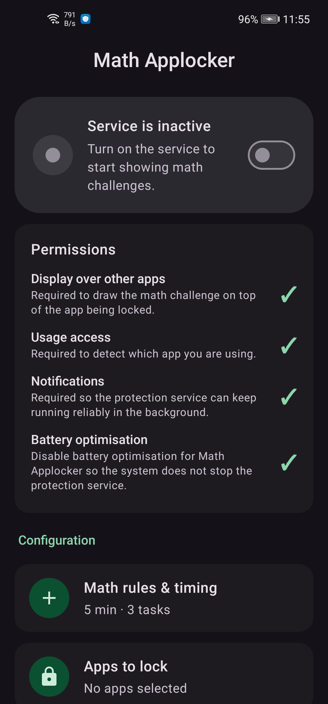
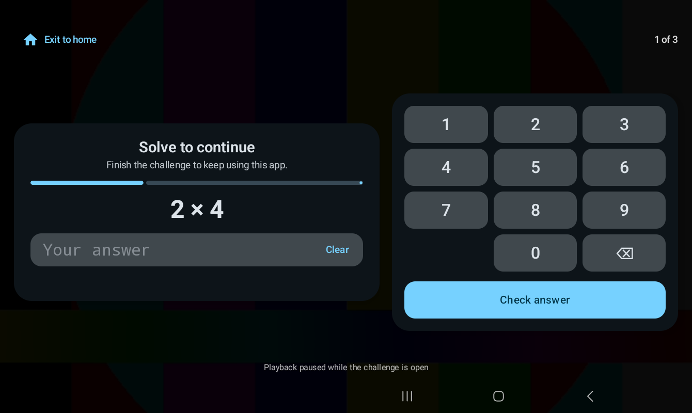

# Math Applocker

A modern, privacy-friendly parental-control app for **Android 10+** that gates selected apps behind a short math challenge. This is a clean-room rewrite of an older app with no ads, no tracking, no network access, and no subscriptions.

<p align="center">
  
  
</p>

## Features

- **Real system overlay** — the challenge is a `TYPE_APPLICATION_OVERLAY` window drawn on top of the locked app. It appears instantly, does not hijack the task stack, and does not push video apps into Picture-in-Picture.
- **Media-aware** — while a challenge is open, media playback is paused via transient audio focus, with a media-key fallback for players such as VLC and Jellyfin. Playback resumes after a correct answer.
- **Option A timing** — the first time a selected app is opened you get a challenge. After solving it, all selected apps stay unlocked for the configured interval (wall-clock minutes). After that, the next visit (or staying in the app) triggers a new challenge.
- **Battery-friendly detection** — foreground detection uses `UsageStatsManager` events and pauses completely while the screen is off.
- **PIN protection** — 4-digit PIN hashed with salted PBKDF2-HMAC-SHA256 (not a single SHA-256), with a lockout after repeated failures. The app re-locks shortly after it goes to the background.
- **Basic and Advanced modes** — Basic generates questions from the age, digit and operation settings. Advanced replaces generated questions with your own challenge sets and the tables you select.
- **Custom challenge sets** — group numeric or free-text questions into named sets, toggle sets and individual questions on or off, and mix any combination into challenges. Numeric questions use a calculator-style parser that rejects invalid expressions and wrong answers; text answers ignore case, accents and extra spaces. Stored locally in Room.
- **Multiplication tables** — in Advanced mode, toggle the 1×–9× tables to include their facts in custom challenges.
- **Age presets and digits (Basic)** — six difficulty levels from 3–4 years to adult, a 1–4 digit override for generated operands, and selectable operations (+, −, ×, ÷). Division always has an exact integer answer.
- **Material 3 / dynamic color** — Material You wallpaper colors on Android 12+, with a green fallback palette on Android 10–11.
- **English and Spanish** — fully localized, switchable in-app.
- **No network** — the app does not request the `INTERNET` permission.

## Requirements

- Android 10 (API 29) or newer. Tested on Android 10 (EMUI 10.1) and Android 13.
- Three special permissions, granted from the home screen:
  1. **Display over other apps** (`SYSTEM_ALERT_WINDOW`) — to draw the challenge.
  2. **Usage access** (`PACKAGE_USAGE_STATS`) — to detect the foreground app.
  3. **Notifications** (Android 13+) — to run the foreground service reliably.

Optionally disable battery optimization so the system does not stop the protection service.

### Huawei / EMUI notes

On EMUI (Huawei P40 lite and similar), also enable **App launch → Manage automatically** for Math Applocker, and lock the app in the recent-apps screen. These OEM controls are outside the standard Android APIs; without them EMUI may kill the foreground service when the screen is off.

## Building

You need **JDK 17** and the Android SDK with **platform 35** and **build-tools 35.0.0**.

```bash
# Point Gradle at your SDK (or set ANDROID_HOME)
echo "sdk.dir=$HOME/android-sdk" > local.properties

./gradlew assembleDebug
# APK: app/build/outputs/apk/debug/app-debug.apk
```

Run the unit tests:

```bash
./gradlew testDebugUnitTest
```

### Release builds and signing

Release builds are minified with R8. Signing is optional and configured through a
`keystore.properties` file at the repository root (git-ignored):

```properties
storeFile=/absolute/path/to/mathapplocker-release.jks
storePassword=your-store-password
keyAlias=mathapplocker
keyPassword=your-key-password
```

Create a keystore once:

```bash
keytool -genkeypair -v \
  -keystore ~/.android/mathapplocker-release.jks \
  -alias mathapplocker -keyalg RSA -keysize 4096 -validity 10000
```

Then:

```bash
./gradlew assembleRelease
# APK: app/build/outputs/apk/release/app-release.apk
```

Without `keystore.properties`, the release APK is produced unsigned.

## How it works

```
MainActivity (Compose, Material 3, dynamic color)
 ├─ PIN setup / PIN auth (PBKDF2, lockout)
 ├─ Home (service switch, permission status, Basic/Advanced mode switch)
 ├─ Math rules (basic: presets, digits, operations, interval, task count)
 ├─ Custom challenges (advanced: timing, multiplication tables, sets)
 ├─ App picker (async labels, lazy icons, search)
 └─ Custom questions inside challenge sets (numeric + text answers)

OverlaySchedulerService (foreground, specialUse)
 ├─ ForegroundAppDetector (UsageStats events, cached, screen-aware)
 ├─ QuestionGenerator (basic generation, or advanced custom-only pool)
 ├─ MediaPauseController (audio focus + media key fallback)
 └─ OverlayController
      └─ TYPE_APPLICATION_OVERLAY window
           └─ Compose quiz (portrait and landscape layouts)
```

Design decisions worth knowing:

- **Mode separation.** Basic mode ignores challenge sets and multiplication tables; Advanced mode uses only them. If nothing is enabled in Advanced, the app falls back to Basic questions so a challenge can never be empty (an empty challenge would auto-solve).
- **Settings apply immediately.** There is no Save button to forget; interval/tasks and all selectors persist as you change them. Changing the age preset resets the digit setting to Auto so a previous 3-digit choice cannot leak into a 5–7 preset.
- **Overlay language.** On Android 10, AppCompat's in-app language only reaches Activities. The service therefore builds the overlay and notification with a configuration context for the saved language, so the challenge and its notification match the app.
- **Overlay instead of a launched Activity.** Launching an Activity from the background is restricted since Android 10 and causes task/recents glitches and PiP surprises. A system overlay is immediate and independent of the activity stack.
- **Back is swallowed** inside the overlay; the explicit **Exit to home** button is the only escape, and it keeps playback paused until the challenge is solved.
- **Leaving the app** (Home, recents, notification) dismisses the overlay so it never floats above the launcher.
- **Home-key friendly.** Dismissing the overlay does not count as solving it; re-opening the locked app shows the challenge again.
- **Unlock window** is global: after a solved challenge all selected apps are unlocked for the configured interval.

## Privacy

- No analytics, crash reporting, ads, or billing libraries.
- No `INTERNET` permission; the app cannot talk to the network.
- Settings, PIN hash, and custom questions stay on the device.
- Usage access is used only in-memory to detect the foreground package; usage history is never stored.

## License

GPL-3.0-or-later. See [LICENSE](LICENSE).
